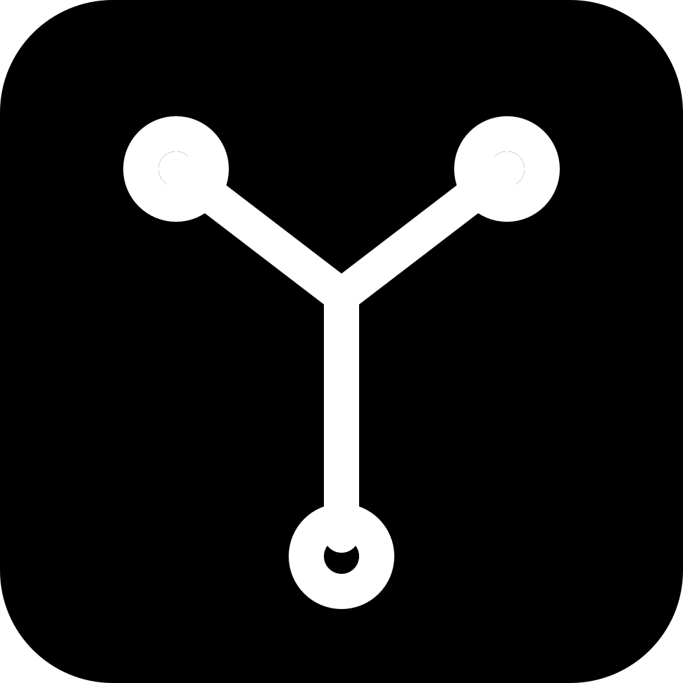

<div align="center">
  
  <h1>gray-git-merge</h1>
  <p><strong>/merge <branch> runs git merge, and conflicts hand the model a resolve prompt.</strong></p>
  <p>
    <a href="https://gray.alignment.id">Website</a> ·
    <a href="https://gray.alignment.id/plugins/gray-git-merge">Store</a> ·
    <a href="https://github.com/vstaln/gray-git-merge">Source</a> ·
    <a href="https://github.com/vstaln/gray">gray</a>
  </p>
  <p>
    <a href="LICENSE"></a>
    <a href="https://www.rust-lang.org"></a>
    <a href="https://gray.alignment.id/plugins/gray-git-merge"></a>
  </p>
</div>

<br/>

```bash
gray plugin install gray-git-merge
```

`/merge <branch>` runs `git merge` in the session repo; conflicts hand the
model a resolve prompt plus the `git_conflicts` tool.

A sidecar plugin for [gray](https://github.com/vstaln/gray), scaffolded by
[gray-account](https://github.com/vstaln/gray-account).

## What it does

- `/merge <branch>` → `git -C <session.cwd> merge <branch>`.
  - Clean merge → reported back as `{text}`.
  - Conflicted merge → `{prompt}` (fed to the model): lists the unmerged
    files and tells it to fix the markers and stage each file.
- `git_conflicts` tool:
  - `{action:"list"}` → every `git diff --diff-filter=U` path, flagging files
    whose `<<<<<<<` markers are still present.
  - `{action:"mark-done", file}` → refuses while markers remain, otherwise
    `git add file` and reports what's left.
  - `cwd` arg optional; defaults to the cwd `/merge` recorded in
    `~/.gray/git-merge/last.json`, then the sidecar's own cwd.

Merging is explicit: gray's wire has no per-turn merge hook that fits, so
run `/merge` when you want the merge to happen.

## Wire methods

`plugin/manifest`, `tool/call`, `command/run`, `plugin/shutdown`.

## Install

```sh
gray plugin install git-merge
```

## Develop

```sh
cargo test
cargo build --release
gray account check      # entry point + manifest handshake
```

## Tags

`gray` `plugin` `git-merge` `rust`

---
Part of the [gray](https://github.com/vstaln/gray) plugin ecosystem —
the open-source AI agent harness. <https://gray.alignment.id>
